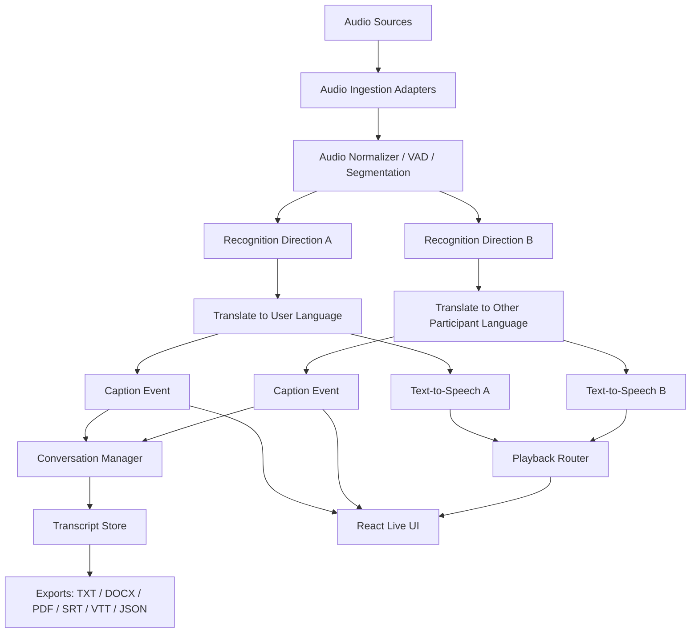
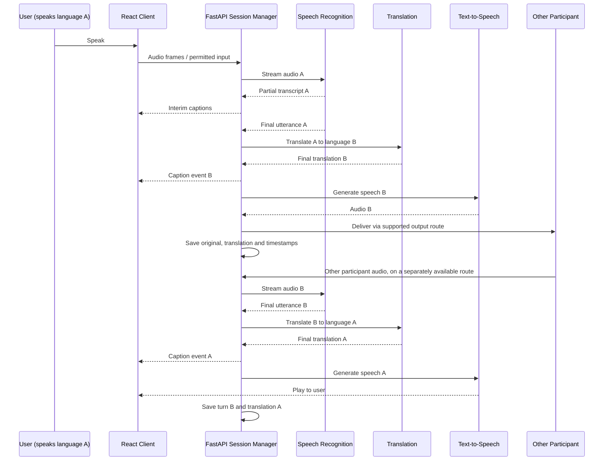
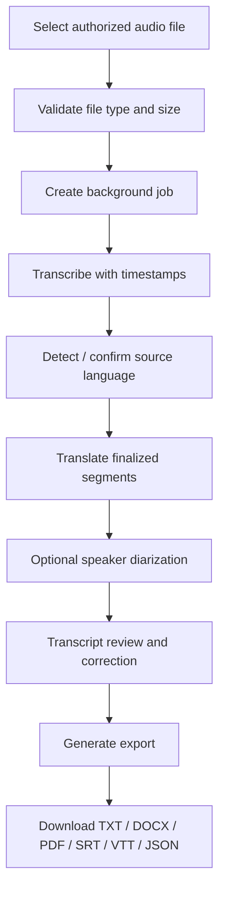

# AI Two-Way Real-Time Voice Translator — Architecture Blueprint

## 1. Product goal

Build a consent-based application that translates conversations in both directions in near real time. The user can speak their own language, the other participant can speak another language, and each side can hear the translation in their own selected language. The application shows live translated captions and saves a timestamped transcript for download.

**Core distinction:** translation, speech synthesis, and delivering audio into a call are three different things. Generating speech does not automatically route that speech to the remote caller.

## 2. Scope and operating modes

1. **Live microphone prototype:** capture permitted microphone audio; display translated captions; optionally speak the translation. Best for validating the AI pipeline.
2. **Saved recording:** upload an authorized recording, transcribe/translate it, review the transcript, export captions and documents.
3. **Live telephony integration:** use a supported provider or call architecture that actually exposes a permitted call-audio stream. This is a separate integration and feasibility track.
4. **Ordinary iPhone cellular calls:** do not assume an app/browser can directly access both sides of a normal cellular call. Apple call recording is only available in selected regions/languages, and recording announces itself to both participants. A provider-based calling workflow is the more controllable path for real-time two-way audio.

## 3. High-level architecture



## 4. Logical layers

### A. Client and interface
- React + TypeScript web app initially; optional native iOS app later.
- Live conversation screen with source language, target language, caption stream and speaker labels.
- Controls: start/stop, mute translated voice, repeat last translation, pause playback, language selection, consent indicator, download and delete.
- Use headphones in microphone mode to reduce feedback from generated speech.

### B. Audio ingestion adapters
Keep different audio sources behind a common interface:
- `MicrophoneInputAdapter`: browser microphone stream for prototype.
- `FileUploadAdapter`: saved audio files.
- `TelephonyStreamAdapter`: only for an authorized provider/audio stream.

Each adapter provides audio chunks plus source metadata and timestamps. Avoid writing separate translation logic for each audio source.

### C. Audio processing
- Audio format validation and normalization.
- Voice activity detection (VAD) to detect speech and pauses.
- Segment buffering, sequence numbers and timestamp tracking.
- Optional noise reduction and sample-rate conversion.
- Backpressure and recovery when a network or model endpoint falls behind.

### D. Speech recognition and language identification
- Stream audio where supported; handle partial and final transcription events separately.
- Identify source language automatically where supported, but allow per-participant language selection to reduce wrong-language guesses.
- Keep original text and detected language in transcript records.
- For mixed-language speech, expect occasional language-switching errors and preserve a correction path.

### E. Translation service
Two independent translation directions run through the same abstraction:
- Direction A: `other_speaker_language -> user's_language`.
- Direction B: `user_language -> other_speaker_language`.
- Translate stable phrases/utterances instead of every unstable partial token.
- Maintain ordering and idempotency keys so retries do not create duplicate captions or duplicated speech.
- Where language detection is uncertain, mark the segment for review rather than silently asserting certainty.

### F. Text-to-speech and playback
- Generate speech in the target language for finalized translations.
- Use a per-direction playback queue, sequence ordering, cancellation and interrupt controls.
- Do not feed synthesized audio back to source transcription when an isolated audio route is available.
- On telephony routes, convert TTS output to the audio encoding expected by the provider.

### G. Conversation manager
- Merge both directions into one chronological timeline.
- Store participant/speaker, source and target language, original text, translation, start/end timestamps, status (`interim`, `final`, `corrected`), confidence if available, and source adapter.
- Deduplicate events and mark final segments immutable except when the user explicitly edits them.
- Export should use finalized segments by default.

### H. Backend APIs and real-time transport
Suggested FastAPI routes:
- `POST /api/sessions` — create a conversation session.
- `POST /api/sessions/{id}/stop` — stop processing and finalize the transcript.
- `WS /api/sessions/{id}/stream` — permitted audio and real-time event channel for prototype-specific streaming.
- `POST /api/recordings` — upload an authorized saved recording and create a job.
- `GET /api/jobs/{id}` — job progress and result metadata.
- `GET /api/sessions/{id}/transcript` — retrieve finalized transcript.
- `GET /api/sessions/{id}/export?format=txt|docx|pdf|srt|vtt|json` — export.
- `DELETE /api/sessions/{id}` — delete transcript and associated files under retention policy.

Keep provider-specific API keys on the backend. For direct browser-to-realtime services, only use short-lived, scoped credentials if the provider explicitly supports them; never embed a long-lived secret in frontend code.

## 5. Live bidirectional workflow



The two-direction flow assumes two usable audio paths. If the application only captures a mixed speakerphone signal, reliable speaker separation may not be possible.

## 6. Saved-recording workflow



Long recordings should use background jobs with status/progress rather than holding a single HTTP request open. Keep enough timing metadata for subtitle export.

## 7. iPhone and telephony integration options

### Option 1: native iPhone call recording (post-call)
Use only where the iPhone feature is available and participants consent. Export the recording through a supported workflow and send it to the saved-recording pipeline. This is not live translation.

### Option 2: speakerphone + a separate microphone
Can be used for an early demonstration if participants consent, but environmental sound, echo and speaker identity may degrade accuracy. This is not robust enough to guarantee reliable call translation.

### Option 3: provider-managed telephony call (recommended for true live calling)
Use a telephony platform that provides authorized inbound/outbound audio streaming and permits sending audio back into the call. Its WebSocket/audio format becomes a `TelephonyStreamAdapter`. Provider-specific setup, pricing, geography, regulatory requirements and phone-number capabilities must be validated before committing.

### Option 4: native iOS calling app
Investigate Apple's supported call frameworks and app models, but do not assume CallKit gives an app access to the audio of ordinary calls placed in Apple's Phone app. A VoIP call that your app/provider manages is a different architecture from intercepting a native cellular call.

## 8. Data model

Suggested entities:
- `User`: id, auth provider, settings.
- `ConversationSession`: id, owner, source adapter, participant language preferences, started/ended times, state, consent metadata.
- `Utterance`: id, session id, speaker id, source language, target language, original text, translated text, start/end milliseconds, interim/final status, confidence if provided.
- `AudioAsset`: id, session/job id, storage location if stored, content type, size, retention expiry.
- `ExportJob`: id, session id, format, status, download expiry.

Use SQLite for a single-user local prototype. Use PostgreSQL for multi-user production. For production audio storage, use private object storage with expiring signed access and lifecycle deletion rules.

## 9. Suggested repository structure

```text
ai-voice-translator/
  frontend/
    src/components/
    src/features/live-session/
    src/features/recordings/
    src/features/transcript/
    src/services/api.ts
  backend/
    app/main.py
    app/api/sessions.py
    app/api/recordings.py
    app/api/exports.py
    app/services/audio_ingestion/
    app/services/speech_recognition.py
    app/services/translation.py
    app/services/tts.py
    app/services/conversation_manager.py
    app/services/export_service.py
    app/models/
    app/core/config.py
  workers/                 # background recording jobs
  tests/
  docs/
  .env.example
  .gitignore
  CLAUDE.md
  README.md
```

## 10. Security, privacy and consent

- Ask for informed consent before recording or processing speech; follow applicable law and platform rules.
- Present a visible listening/recording indicator and a one-click stop control.
- Explain when audio leaves the device and is sent to an AI service.
- Keep long-lived API keys in backend environment variables or a secrets manager.
- Enforce user/session authorization on every transcript and export route.
- Validate uploads, limit file size and duration, rate-limit expensive APIs, and never execute uploaded content.
- Establish a retention policy; delete audio and transcripts through an explicit deletion workflow.
- Avoid logging raw audio or sensitive transcript content by default.
- Use TLS/HTTPS in deployment and encrypt stored sensitive data where appropriate.

## 11. Reliability and latency requirements

Instrument separate timings for audio capture, recognition, translation, TTS generation, playback and end-to-end latency. Track translation errors, missed/duplicate segments, reconnects and dropped audio. Use retries only for safe/idempotent operations. Avoid overpromising instant or perfect translation, especially with overlapping speech, noise, names, idioms and code-switching.

## 12. Phased delivery plan

1. **Foundation:** React UI, FastAPI, health endpoint, configuration, consent screen and session state.
2. **One-way microphone prototype:** language recognition, translation to English, captions and English TTS.
3. **Reverse direction:** source-language choice for each participant, translate user speech into the other language and generate target-language speech.
4. **Shared transcript:** merge both directions, timestamps, editing, TXT/SRT/VTT/JSON export, then DOCX/PDF.
5. **True streaming:** stable interim/final events, queue management, interruptions, reconnection, latency metrics and tests.
6. **Saved recordings:** upload validation, background jobs, timestamped transcription, translated segments, review UI and export.
7. **Telephony feasibility spike:** compare provider-managed two-way streaming against the desired iPhone workflow; test call audio in both directions before broad implementation.
8. **Production hardening:** authentication, PostgreSQL, private storage, deletion/retention, monitoring, deployments and formal privacy review.

## 13. Acceptance criteria for first useful release

- User can start and stop a microphone session with consent.
- Spoken language is transcribed and translated into English with understandable latency.
- Final English captions appear once and are not duplicated.
- Spoken English translation can be toggled on/off and does not create a feedback loop during headphone use.
- Reverse-direction translation works when the target language is configured.
- Both directions appear in correct chronological order with speaker labels and timestamps.
- TXT and SRT exports are downloadable and basic subtitle timings are verified.
- Missing API keys, network errors, unsupported audio and denied microphone permissions produce understandable errors.
- The UI clearly states that microphone mode does not automatically capture ordinary iPhone cellular-call audio.

## 14. Official technical references to verify during implementation

- OpenAI audio guide: https://platform.openai.com/docs/guides/audio
- OpenAI Realtime API: https://platform.openai.com/docs/guides/realtime
- Twilio Media Streams: https://www.twilio.com/docs/voice/media-streams
- Twilio WebSocket messages: https://www.twilio.com/docs/voice/media-streams/websocket-messages
- Apple CallKit: https://developer.apple.com/documentation/callkit
- Apple iPhone call recording: https://support.apple.com/en-asia/guide/personal-safety/ipsfa513e1a6/web

Provider capabilities, model identifiers, prices and regional availability can change; confirm these against the selected provider before implementation.
